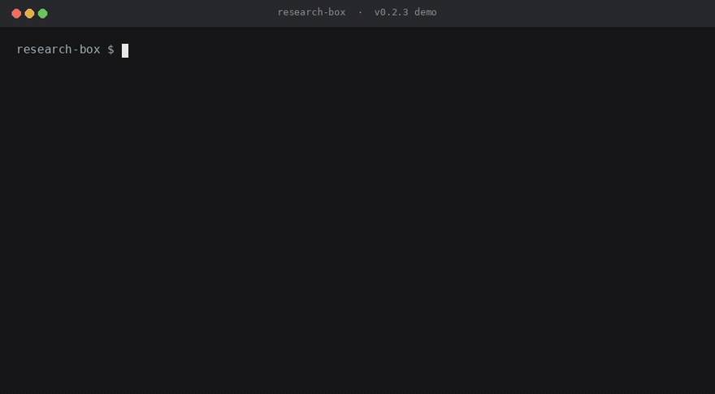

# research-box

An Agent Skill for keeping related research work together: documents, spreadsheets, diagrams, code, data, chats and agent tasks bundled into a named **box**, with sharing levels that only narrow.

Say "make a box called prime-numbers", "add this sheet to the box", "drop the box about prime numbers", "open box prime-numbers" or "give the box to my other agent", and the agent knows what to do.

- **Live layer:** links that stay current. Agents of the same assistant hand each other links, not files.
- **Snapshot layer:** a dropped folder with exported files, a readable `BOX.md`, an RO-Crate 1.1 `ro-crate-metadata.json`, and SHA-256 checksums of every file.
- **Sharing levels:** private, same assistant, shareable. A drop for wider readers leaves out what is not cleared for them, writes a clean copy that holds nothing else, and says what it left out.
- **Checks:** `--check` tells you whether any file in a drop, including its own description, changed or was copied stale, and a list of watch words flags private terms that are about to leave in a shareable drop.

## Quick demo

From a clone of this repository, using the example box in `examples/prime-numbers`:



```
$ python3 research-box/scripts/build_box.py examples/prime-numbers --for shareable --out /tmp/prime-share
prime-numbers: 2 item(s) kept, 2 file(s) checksummed, written to /tmp/prime-share
Left out for shareable readers: Working notes, Planning chat
Watch words in code/simulate.py: Project Lantern (advisory; --strict refuses the drop)

$ python3 research-box/scripts/build_box.py /tmp/prime-share --check
All files match the manifest.

$ printf '\n# edited\n' >> /tmp/prime-share/sheet/results.csv
$ python3 research-box/scripts/build_box.py /tmp/prime-share --check
Changed since the last drop: sheet/results.csv
```

`--check` exits 0 when the drop matches its manifests and 1 after the edit. Add `--strict` to the first command and the drop is refused until the watch word is removed.

## Contents

```
research-box/
  SKILL.md                     instructions the agent follows
  references/box-format.md     the box.json format and how it relates to RO-Crate and BagIt
  scripts/build_box.py         writes BOX.md, RO-Crate metadata and checksum manifests; checks drops
  assets/box.example.json      an example box
  LICENSE                      Apache License 2.0
  NOTICE                       copyright and attribution
.claude-plugin/                plugin manifest, marketplace file and icon
examples/prime-numbers/        a small box to try the script on
tests/test_build_box.py        unittest suite, standard library only
```

`build_box.py` uses the Python standard library only.

## Try it

The commands and the output in [Quick demo](#quick-demo) were run against this revision. To run the 23-test suite:

```
python3 -m unittest discover tests
```

The example box has one item at each sharing level and a watch word left in a shareable file, so each safeguard shows. The tests cover the drop rules, labels, path containment, watch words and the check's exit status.

Manifests can also be verified without the script: `shasum -a 256 -c manifest-sha256.txt`.

## Install

The skill follows the open Agent Skills format (agentskills.io). Copy the `research-box` folder into your agent's skills directory, or upload it as a skill in an app that supports skills. You can also install it with the skills CLI:

```
npx skills add PaoloTCS/research-box
```

In Claude Code, the repository is also a plugin marketplace, so the skill installs as a plugin in one step:

```
/plugin install research-box --marketplace PaoloTCS/research-box
```

## What it runs

The skill tells the agent to run `research-box/scripts/build_box.py`, a Python script that uses the standard library only. It reads and writes files in the box folder you name and in the `--out` folder, and nothing else. It makes no network calls, sends nothing anywhere, and never deletes files. The live links a box lists are opened by the agent with its own tools, not by the script.

## Versions

- **0.2.5** (November 19, 2026), from the first real user's bug report: watch words match whole words and phrases, not substrings, so a short private term no longer matches inside ordinary words such as "file" and blocks every strict drop; each hit is reported with its file, line and context; held-back state lines and box details are reported like held-back items. 27 tests.
- **0.2.4** (November 19, 2026): packaged as a Claude Code plugin (`.claude-plugin/plugin.json` and a one-plugin marketplace), with an icon and a note on what the script runs. No change to the skill or the script.
- **0.2.3** (November 19, 2026), after a third outside review: state-line labels survive repeated exports; fields outside the format are never copied into a drop; a missing declared snapshot, or one file listed under two sharing levels, refuses the drop; `--check` returns 2 (incomplete) without a tag manifest; watch words are scanned in every generated file, and `--strict` refuses a shareable drop that contains them; clearer wording on what checksums do and do not prove. 23 tests.
- **0.2.2** (November 19, 2026), after a second outside review: snapshot paths must stay inside the box folder (absolute paths, `..` and outside symlinks are refused before anything is written, and `--check` flags manifest paths outside the folder); `--help` and usage errors print usage instead of a traceback; a runnable example box and a 15-test suite (27 tests as of 0.2.5).
- **0.2.1** (November 19, 2026), after review by an early user: `--out` is required for any drop that holds something back, so held-back files can never be left beside shared ones; `--check` exits 1 on any changed, missing or unlisted file and 2 with no manifest, so pipelines can gate on it.
- **0.2** (November 19, 2026), after the first real drops: box details and state lines follow the box's sharing level, with an optional `public` block for wider drops; `--out` writes a clean filtered copy; `--check` compares a drop with its manifest and a BagIt-style tag manifest, after every copy and before a refresh; watch words (`private_terms`); item revisions; registry label mapping (`level_labels`).
- **0.1** (November 19, 2026): first version.

## Dedication

Released November 19, 2026, with thanks to the people at Anthropic who made Claude, which helped build it.

## Credits

Created by **Paolo Pignatelli**. Developed in collaboration with **Claude**, an AI model made by **Anthropic**, which drafted and tested the skill text, the manifest format and the build script (November 2026).

This project is not affiliated with or endorsed by Anthropic.

## License

Apache License 2.0. See `LICENSE` and `NOTICE`; copies sit inside `research-box/` so the skill folder is complete on its own. If you redistribute the skill, keep the NOTICE file, which carries the attribution above.
